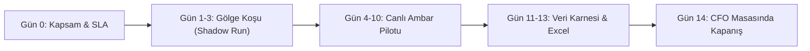

# DOCULOG WORKSTATION — KURUMSAL STRATEJİ, ROI VE GTM ZİRVESİ RAPORU
**Belge Kodu:** STRAT-2026-DOCULOG-01  
**Hedef Kitle:** İcra Kurulu, Kurucu ve Çözüm Mimarları  
**Yazar:** Kıdemli Kurumsal Stratejist & Çözüm Mimarı (Enterprise B2B Logistics Strategist)  
**Tarih:** 24 Ekim 2026  

---

## 1. YÖNETİCİ ÖZETİ (EXECUTIVE SUMMARY)

Lojistik sektörü dijitalleşmede kritik bir paradoks yaşamaktadır: Türkiye'de Gelir İdaresi Başkanlığı (GİB) nezdinde **e-İrsaliye zorunluluğu** yürürlükte olmasına rağmen, sahadaki fiziksel operasyon halen **kağıt, buruşuk A4 nüshalar ve el yazısı ambar şerhleri** üzerinden dönmektedir.

Ekol, Borusan, Horoz, Netlog gibi devasa 3PL işletmecileri ve Vestel, Arçelik, Hayat Kimya gibi mega üreticilerin ambar rampalarında (dock) her gün yüzbinlerce sevk irsaliyesi manuel olarak ERP sistemlerine (SAP EWM, Logo Tiger, IFS, Soft Lojistik vb.) tuşlanmaktadır. Bu darboğaz;
- Rampa başına **4 ila 8 dakika** evrak kabul gecikmesine,
- **%3 ila %7** arasında hatalı veri girişine (kod kayması, birim hatası, miktar hatası),
- Taşıyıcı araçların tesiste beklemesi sebebiyle oluşan **Demurrage (Bekleme Tazminatı)** maliyetlerine,
- Ay sonlarında fatura mutabakatlarının kilitlenmesine yol açmaktadır.

**DocuLog Workstation**, basit bir OCR tarayıcısı değil; ambar rampasında **"Sıfır Hata Mal Kabul İstasyonu"** ve **"Finansal & Operasyonel Mutabakat Motoru"** olarak konumlanmalıdır. Bu rapor, DocuLog'un ilk kurumsal satışını **10.000$ - 25.000$+** bandında kapatması ve 12 ay içinde Türkiye lojistik pazarında kopyalanamaz bir teknolojik hendek (moat) inşa etmesi için gerekli yol haritasını sunar.

---

## 2. PAZAR VE MÜŞTERİ PROFİLİ: KANAYAN YARA VE ROI HESABI

### 2.1 Ambar Rampasındaki Gerçek Kanayan Yara: "Fiziksel-Dijital Çelişkisi"
Türkiye'de 3PL ambarlarına veya fabrika kabul depolarına giren bir kamyonda ortalama 10 ile 60 arasında sevk irsaliyesi bulunur.
1. **Kağıt Üzerindeki El Yazısı Şerh (İhtirazi Kayıt):** GİB portalındaki XML faturada/irsaliyede 1.000 koli yazar. Ancak kamyon açıldığında 4 koli ezik, 2 koli ıslak, 1 palet eksiktir. Ambar kabul şefi fiziksel kağıdın üzerine tükenmez kalemle *"4 koli hasarlı teslim alındı, Lot: 44A eksik"* yazar ve şoföre kaşeletir.
2. **ERP Çıkmazı:** GİB e-irsaliye entegratörleri bu el yazısını göremez. Veri giriş personeli kağıdı eline alıp tek tek kalemleri WMS/ERP'ye girmeye çalışır.
3. **Süre Kaybı:** Kalem sayısı yüksek bir sanayi irsaliyesinin (örneğin beyaz eşya vida, kablo grupları, rulman) sisteme girilmesi **12-15 dakikayı** bulur. Kamyon kapıda bekler, arkadaki 15 tır rampa kuyruğuna girer.
4. **Mutabakat Faciası:** Ay sonunda satıcı firma 1.000 koli üzerinden fatura keser, alıcı firma muhasebesi "Bizde 994 koli görünüyor" der. Arşivden kağıt irsaliye aranır, bulunamazsa firma zararı sineye çeker.

### 2.2 Matematiksel ve Finansal ROI Modeli (CFO & Ambar Direktörü Önüne Konacak Hesap)

Aşağıdaki hesaplama, Türkiye'de tipik bir **Orta-Büyük Dağıtım Merkezi (DC)** (Örn: Gebze veya Hadımköy'de günde ortalama 600 irsaliye kabul eden, 15-20 rampalı bir 3PL veya üretim tesisi) baz alınarak yapılmıştır.

#### Girdi Değişkenleri:
- **Günlük Gelen İrsaliye Hacmi:** 600 adet
- **Aylık Çalışma Günü:** 25 gün (Aylık 15.000 irsaliye)
- **Mevcut Manuel İşleme Süresi:** 5 dakika / irsaliye (Kontrol + ERP tuşlama)
- **Günlük Harcanan İşgücü:** 600 evrak × 5 dk = 3.000 dakika = **50 adam-saat / gün**
- **Mevcut Veri Giriş Ekibi:** 6 Tam Zamanlı Personel (FTE) (2 vardiya)
- **Personel Aylık İşveren Maliyeti (TR 2026 ortalama):** ~45.000 TL (~1.300 USD)
- **Yıllık Veri Giriş Personel Maliyeti:** 6 × 1.300$ × 12 = **93.600 USD / yıl**

#### Hata ve Anomali Maliyeti:
- **Manuel Tuşlama Hata Oranı:** %2 (Ayda 300 hatalı kayıt)
- **Hatalı Kayıt Başına Çözümleme Maliyeti:** 200 TL (~6 USD) (Ters kayıt, iade lojistiği, ambar sayım farkı, fatura düzeltme mesaisi)
- **Aylık Hata Maliyeti:** 300 × 6$ = 1.800 USD / ay (**21.600 USD / yıl**)

#### DocuLog Workstation ile Sağlanan İyileşme:
- **DocuLog Sayısallaştırma + Kontrol Süresi:** 35 - 45 saniye / irsaliye (DocuLog otomatik okuma: 2.4 sn + operatör tek tık onayı ve ERP kopyalama: 35 sn)
- **Hızlanma Oranı:** **%88 zaman tasarrufu**
- **Gereken Personel:** 6 FTE'den **2 FTE'ye** düşüş (4 personel katma değerli rampa sayım ve kalite kontrol işlerine kaydırılır).
- **Net İşgücü Tasarrufu:** 4 FTE × 1.300$ × 12 = **62.400 USD / yıl**
- **Mutabakat ve Hata Engelleme Tasarrufu:** Canlı matematiksel dip toplam mutabakatı ve Smart Quarantine sayesinde hatalı girişler %0.2'nin altına iner: **18.000 USD / yıl**
- **Rampa Kapasite Artışı:** Tır kabul süresi kısaldığı için günlük rampa throughput'u **%30 artar**. Tesis, yeni bir depo kiralamadan mevcut kapasitesiyle daha fazla yük kabul eder.

| Kalem | Mevcut Manuel Operasyon | DocuLog Workstation | Yıllık Net Tasarruf |
| :--- | :--- | :--- | :--- |
| **Doğrudan Veri Giriş İşgücü** | 93.600 USD | 31.200 USD | **62.400 USD** |
| **Hatalı Giriş ve Düzeltme Gideri** | 21.600 USD | 3.600 USD | **18.000 USD** |
| **Demurrage (Bekleme Cezası) Azalımı** | ~15.000 USD | ~2.000 USD | **13.000 USD** |
| **TOPLAM YILLIK FAYDA** | **130.200 USD** | **36.800 USD** | **93.400 USD** |

> **CFO'ya Sunulacak ROI Cümlesi:**  
> *"DocuLog Workstation yıllık 18.000 USD lisans bedeliyle tesisinize kurulduğunda, ilk yıl net **75.400 USD tasarruf** sağlar. Yatırımınızın geri dönüş süresi (Payback Period) tam **2.3 aydır**."*

---

## 3. FİYATLANDIRMA VE GELİR MODELİ: 10.000$ - 25.000$+ KONTRAT MİMARİSİ

### 3.1 Neden Salt Sayfa Başı Mikro-Fatura ($0.05/evrak) Kurumsal Masada Kaybettirir?
- **Bütçe Belirsizliği:** Kurumsal CFO'lar her ay dalgalanan faturalardan hoşlanmaz. "Yoğun sezonda (Black Friday vb.) yazılım bütçemiz patlar mı?" endişesi satın almayı bloke eder.
- **Emtia Algısı:** Sayfa başı fiyatlama, sizi bulut OCR sağlayıcılarının (Google Vision, AWS Textract) seviyesine indirir. Halbuki DocuLog bir OCR değil; **WMS/ERP entegre lojistik karar destek sistemidir**.

### 3.2 Önerilen Model: "Facility-Based Tiered Annual License + Managed Connectors" (Tesis/Rampa Bazlı Kademeli Yıllık Model)

Yıllık peşin veya 2 taksitli kurumsal taahhüt modeli:

```
┌────────────────────────────────────────────────────────────────────────┐
│                      DOCULOG ENTERPRISE PAKETLERİ                      │
├───────────────────────┬────────────────────────┬───────────────────────┤
│ TIER 1: REGIONAL DC   │ TIER 2: 3PL MEGA HUB   │ TIER 3: ENTERPRISE    │
│ (Bölge Depo/Fabrika)  │ (Büyük Aktarma Merkezi)│ (Çok Tesisli Filo)    │
├───────────────────────┼────────────────────────┼───────────────────────┤
│ • Yıllık: 12.000 USD  │ • Yıllık: 24.000 USD   │ • Yıllık: 45.000$+    │
│ • 10 Rampaya kadar    │ • 30 Rampaya kadar     │ • Sınırsız Rampa      │
│ • 120.000 Evrak/Yıl   │ • 300.000 Evrak/Yıl    │ • 1.000.000+ Evrak/Yıl│
│ • Tek ERP Entegratörü │ • Çift ERP/WMS Konnektör│ • Özel On-Prem / VPC │
│   (Logo Tiger/Go)     │   (SAP EWM + Logo)     │ • Multi-Warehouse     │
│ • Standart SLA        │ • 4 Saat Kritik SLA    │ • 7/24 Özel Çözüm Mimar│
│ • Smart Quarantine    │ • Yönetici Kokpiti     │ • U-ETDS ve GİB       │
│ • Canlı Mutabakat     │ • Excel Raporlama      │   Otomasyon Paketi    │
└───────────────────────┴────────────────────────┴───────────────────────┘
```

### 3.3 Ek Gelir Kalemleri (Expansion & Services Revenue):
1. **Kurulum, ERP Entegrasyonu ve Kalibrasyon Bedeli (Tek Seferlik):** **2.500$ - 4.500$**  
   - Logo Tiger / SAP XML-JSON veri haritalama, ambar personeline yerinde 2 günlük eğitim, ambar ışık/kamera açı kalibrasyonu.
2. **Kota Aşım Ücreti:** Yıllık evrak kotası aşılırsa her ek 1.000 evrak için **50 USD**.
3. **Ek ERP Konnektörü:** İkinci bir WMS veya ERP bağlanması durumunda yıllık **3.500 USD**.

---

## 4. İLK SATIŞI KAPATMA: 14 GÜNLÜK CERRAHİ POK (PROOF OF CONCEPT) STRATEJİSİ

Kurumsal müşteriye "Yazılımımızı deneyin" denmez; **"14 Günlük Değer Doğrulama Denetimi (Value Audit)"** teklif edilir.

### 4.1 14 Günlük Saha Uygulama Protokolü:


- **Gün 0: Kapsam Sabitleme**
  - Müşterinin tek bir ana deposunda (Örn: Gebze DC) tek bir kabul hattı seçilir (Tercihen en çok irsaliye gelen FMCG veya Sanayi Mal Kabul rampası).
  - Başarı Kriterleri Protokolü (Success Agreement) imzalanır.
- **Gün 1-3: Gölge Koşu (Shadow Run)**
  - Mevcut ambar sürecine dokunulmaz. Masadaki ambar görevlisi irsaliyenin fotoğrafını DocuLog'a atar. Arka planda geleneksel tuşlama süresi ile DocuLog süresi loglanır.
- **Gün 4-10: Aktif Rampa Kullanımı**
  - Ambar görevlisi verileri artık tek tek elle yazmaz; DocuLog'un ürettiği standart Logo XML/JSON veya "Panoya Kopyala" modunu kullanarak ERP'ye tek tıkla aktarır.
  - "Smart Quarantine" modülü devreye sokulur; alakasız görseller veya kalem-dip toplam uyuşmazlığı olan evraklar anında yakalanır.
- **Gün 11-13: Veri Konsolidasyonu**
  - `GET /api/analytics/export-report` endpoint'i üzerinden resmi denetim Excel raporu (`Resmi_Mal_Kabul_Yonetici_Raporu.xlsx`) oluşturulur.
- **Gün 14: Kapanış Zirvesi (Executive Close Meeting)**
  - Müşterinin Ambar Direktörü ve Satın Alma / CFO'sunun önüne sadece 3 veri konur:
    1. *"14 günde 3.840 irsaliye işlendi. Operatörlerinizin tuşlama süresi 320 saatten 38 saate indi (%88 tasarruf)."*
    2. *"Smart Quarantine ve Matematiksel Doğrulama Motoru, kağıt üzerinde insan gözünün kaçırdığı **11 adet miktar uyuşmazlığını ve 4 adet hasar şerhini** yakalayarak deponuzu 280.000 TL'lik hatalı mal kabul riskinden kurtardı."*
    3. *"Tır başına kabul süreniz 22 dakikadan 6 dakikaya indi."*
  - **Kapanış Sorusu:** *"Bu kazanımları yarın sabah kapatıp eski manuel sisteme mi dönelim, yoksa yıllık sözleşmeyi onaylayıp tüm rampalarınıza mı yayalım?"*

---

## 5. AR-GE VE TEKNİK HENDEK (UNFAIR MOAT) — 6-12 AYLIK YOL HARİTASI

DocuLog'u basit bir AI arayüzü (wrapper) olmaktan çıkarıp devasa rakiplerin aşamayacağı bir **endüstri standardına** dönüştürecek 4 stratejik Ar-Ge hamlesi:

### 5.1 GİB e-İrsaliye QR Kodu ile UBL-TR Hibrit Çapraz Eşleme (Zero-Trust Dispatch Matching)
- **Teknik Açıklama:** Türkiye'deki yasal e-irsaliyelerin sağ üst köşesinde GİB standartlarında karekod bulunur.
- **Ar-Ge Hedefi:** 
  1. DocuLog kamerası irsaliye görüntüsünü aldığı anda QR kodu anında çözer (UUID, VKN, Tarih, Tutar).
  2. Müşterinin e-İrsaliye Özel Entegratör API'sinden (Foriba/Sovos, Logo Özel Entegratör, EDM, Uyumsoft vb.) gelen orijinal UBL-TR XML'i hafızaya çağrılır.
  3. DocuLog Vision AI, fiziksel kağıdın altındaki **el yazısı notları ("2 koli ezik", "kabul edilmedi")** okur ve XML içeriğiyle karşılaştırarak anında **"Kısmi Kabul / İhtirazi Kayıt Yanıt Paketi"** üretir.
- **Hendek Etkisi:** Bu dünyadaki hiçbir global OCR sağlayıcısının (Google, AWS, Azure) sunamayacağı, sadece Türk lojistik mevzuatına özel eşsiz bir katma değerdir.

### 5.2 U-ETDS (Ulaştırma Elektronik Takip ve Denetim Sistemi) Otomasyonu
- **Mevzuat Kaldıracı:** Ulaştırma ve Altyapı Bakanlığı, 4925 sayılı Karayolu Taşıma Kanunu kapsamında yük taşımalarında araç plakası, şoför TC/Adı ve yük bilgilerinin U-ETDS sistemine bildirilmesini zorunlu kılmaktadır. Bildirim yapmayan lojistik firmalarına ağır idari para cezaları kesilmektedir.
- **Ar-Ge Hedefi:** DocuLog'un irsaliyeden ayrıştırdığı taşıyıcı ünvanı, şoför kimliği ve plaka verisini tek tıkla e-Devlet U-ETDS servislerine push eden bir entegrasyon modülü eklemek.
- **Hendek Etkisi:** 3PL firmaları için sadece mal kabul değil, yasal ceza kalkanı haline gelir.

### 5.3 Endüstriyel El Terminalleri İçin Offline-First Edge Tarama
- **Saha Gerçeği:** Ambar sahaları çelik konstrüksiyon ve betonarme binalardır; rampalarda ve koridorlarda Wi-Fi sinyali sık sık kesilir.
- **Ar-Ge Hedefi:** Zebra, Honeywell, Datalogic gibi Android tabanlı el terminalleri üzerinde çalışan, görseli cihazda yakalayıp yerel SQLite'ta kuyruklayan, internet geldiğinde WebSocket üzerinden senkronize olan hafif istemci (PWA / Android Native APK).

### 5.4 Tedarikçi Güvenilirlik & Kaçak/Fraud Anomali Karnesi
- **Veri Zekası:** Zaman serisi verilerini kullanarak tedarikçi bazlı hata indeksi çıkarmak: *"X Tedarikçisinin gönderdiği irsaliyelerin %14'ünde miktar uyuşmazlığı yaşanıyor, teslimatta ortalama %3 fire veriyor."*
- **Hendek Etkisi:** Yazılım ambar çalışanından çıkıp Satın Alma Direktörünün ve Genel Müdürün stratejik karar aracı haline gelir.

---

## 6. GENÇ KURUCU İÇİN MASADA SATIŞ VE MÜZAKERE TAKTİKLERİ

Lise 2 öğrencisi olmak kurumsal masada bir zayıflık değil, **doğru yönetilirse en büyük satış silahıdır**. Türkiye'de sanayi devlerinin üst yöneticileri genç, vizyoner ve sahayı bilen girişimcilere büyük sempati duyar; ancak masada amatörlüğe asla tahammül etmezler.

### 6.1 Masada Nasıl Konuşulmalı? (Dil ve Konumlandırma)

| ❌ KAÇINILMASI GEREKEN SÖYLEM |  KULLANILMASI GEREKEN PROFESYONEL SÖYLEM |
| :--- | :--- |
| "Biz yapay zeka ile irsaliye okuyan bir web sitesi yaptık." | "DocuLog, ambar mal kabul hattında kağıt ve e-irsaliye arasındaki mutabakat açığını kapatan, Logo ve SAP uyumlu bir istasyondur." |
| "Gemini API kullanıyoruz, çok akıllı." | "Tescilli doğrulamalı görüntü işleme motorumuz ve matematiksel çapraz mutabakat algoritmamız sayesinde %99.8 doğrulukla çalışıyoruz." |
| "Fiyatımız sayfa başı 10 kuruş." | "Tesis bazlı yıllık kurumsal lisanslama modeli uyguluyoruz; ambar başına yıllık yatırımınız operasyonel tasarrufunuzun yanında 2.5 ayda kendini amorti eder." |

### 6.2 Masadaki "Canlı Demo" Büyüsü (The Showstopper)
1. Sunuma slaytlarla başlanmaz.
2. Ambar direktörüne denir ki: *"Sayın Genel Müdürüm / Direktörüm, sunumu geçelim. Masanızdaki veya deponuzdaki en kötü, en buruşuk, el yazısıyla karalanmış gerçek bir sevk irsaliyesini bana verebilir misiniz?"*
3. O irsaliye cep telefonuyla çekilir veya Workstation'a sürüklenir.
4. **2 saniye içinde:**
   - Kalemler ayrışır,
   - Toplam tutar ve kalem miktarları matematiksel mutabakatla yeşil yanar,
   - Varsa el yazısı notlar "Smart Quarantine" ve "Notlar" alanında belirir,
   - **"Logo Tiger XML Kopyala"** butonuna basılır ve ERP'ye yapıştırılmaya hazır format ekranda gösterilir.
5. Satış o 10 saniye içinde biter.

---

## 7. SONUÇ VE AKSİYON PLANI

DocuLog Workstation; mimarisi (FastAPI, SQLite WAL, WebSocket, modern React 19 arayüzü), mutabakat zekası ve şimdiden 33 birim testten geçen sağlam omurgasıyla pazara girmeye **teknik olarak hazırdır**.

**Gelecek 30 Günlük Aksiyon Planı:**
1. Kocaeli/Gebze veya İstanbul/Tuzla serbest bölgesinde faaliyet gösteren 3 orta ölçekli 3PL veya imalatçı ile **14 Günlük Değer Denetimi (POC)** başlatılması.
2. İlk kurumsal referansın **12.000$ - 15.000$ Tier-1 yıllık sözleşme** ile kapatılması.
3. GİB e-İrsaliye QR hibrit eşleme Ar-Ge'sinin başlatılması.
